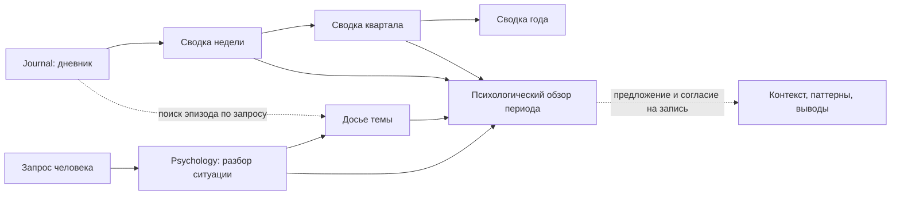

# Journal и Psychology: архитектура Клубка

Дата: 2026-10-31. Статус: основа реализована в рабочей ветке. В `vault/` добавлены контракты Journal и Psychology, карта, целевые папки и шаблоны; существующий разбор использует новый путь. Полная поведенческая проверка и выпуск ещё впереди.

## 1. Что переносим из Obsidian

В исходном хранилище раздел называется **Journal**. Здесь используем это имя для упомянутого Journey.

Изучены структура папок, инструкции разделов, оглавления workflows и заголовки шаблонов. Личные дневники, разборы, досье, портрет и результаты опросников не открывались. Инструкции тоже содержат личный контекст: он не переносится. Этот документ написан заново и описывает только устройство системы.

В основе исходной архитектуры — не две папки, а два способа работы с одними данными:

| Слой | Journal | Psychology |
|---|---|---|
| Вопрос | Что происходило за день или период? | Что происходит с конкретной мыслью или темой и что уже пробовали? |
| Первичный материал | Дневник дня | Ситуация для разбора, слова человека, ссылки на записи |
| Обработка | Сводки: неделя → квартал → год | Разбор ситуации → досье темы → обзор динамики |
| Результат для другого блока | Сводка периода со ссылками на источники | Согласованные выводы и контекст, относящиеся к запросу |
| Главная граница | Хронология не становится психологическим заключением | Гипотеза не становится фактом о человеке |

Ещё четыре принципа исходной структуры стоит сохранить:

1. **У блока есть контракт:** назначение, содержимое, входные данные, результаты, workflows, шаблоны, ритм и ограничения.
2. **Правило имеет одно место:** общее — в корне, правило раздела — внутри раздела, порядок действий — в skill. Карта хранилища указывает, куда идти.
3. **Сводки служат интерфейсом между блоками.** Для обзора периода сначала используется сводка соответствующего масштаба. Поиск конкретного эпизода — отдельная задача с ограниченным чтением первичных записей.
4. **Работа по теме продолжается в её досье.** Запрос, источники, проверяемые гипотезы, попытки и прогресс связаны, а не рассыпаны по новым спискам.

«Интерфейс блока» здесь означает заметки для других частей того же vault. Это не публикация в интернете и не согласие передавать содержимое внешнему сервису.

## 2. Как адаптируем к Клубку

Клубок сохраняет назначение инструмента самопомощи и существующую рамку безопасности. Перестройка хранения не меняет кризисный протокол и не добавляет медицинских обещаний.

| Сейчас в Клубке | Предлагаемое устройство |
|---|---|
| `Journal/` — плоская папка дневника | Блок Journal: текущие записи, архив и сводки |
| `Reviews/` — разборы в корне | `Psychology/Reviews/` — разборы как часть психологического блока |
| Долгосрочной работы по темам нет | Досье, очередь тем и обзор динамики внутри Psychology |
| `Me/` — профиль и пожелания к помощнику | Остаётся общим: страна, обращение, цели знакомства и предпочтения; без психологического портрета |
| Основные правила в одном `vault/CLAUDE.md` | Общая рамка в корне, отдельные инструкции двух блоков |
| `Reference/`, `Templates/` | Остаются общими системными ресурсами |

Не переносим остальные блоки личного хранилища и зависимости от них: Planning, PRM, Finance и другие. Недельный обзор в Клубке не должен требовать финансового разбора, контактов, учебного плана или git-коммита. Личные часы обзоров, накопленный архив, индивидуальные формулировки и примеры тоже не становятся настройками продукта.

## 3. Целевая карта vault

Папки — по-английски, пользовательские заметки и шаблоны — по-русски, даты — `YYYY-MM-DD`, как в текущем Клубке. Это проект путей для следующей реализации.

```text
vault/
├── CLAUDE.md                       общая рамка, безопасность, маршрутизация
├── Карта хранилища.md              навигация и объяснение двух блоков
├── .claude/skills/                 общие оригиналы workflows
├── .obsidian/                     пользовательская настройка Obsidian
├── Me/                            профиль и предпочтения человека
├── Reference/                     системный справочник
├── Templates/                     системные шаблоны
├── Journal/
│   ├── CLAUDE.md                   контракт Journal
│   ├── Daily notes/                текущие и ещё не обобщённые дни
│   └── Archive/{год}/
│       ├── Q{квартал}/
│       │   ├── {дата начала недели}/
│       │   │   ├── YYYY-MM-DD.md
│       │   │   └── 00 Неделя {дата начала недели}.md
│       │   └── 00 Квартал Q{квартал} {год}.md
│       └── 00 Год {год}.md
└── Psychology/
    ├── CLAUDE.md                   контракт Psychology
    ├── План разбора.md             индекс тем со ссылками на досье
    ├── Контекст.md                 необязательная согласованная сводка
    ├── Паттерны и убеждения.md     наблюдения и проверяемые гипотезы
    ├── Что я понял.md              выводы, которые подтвердил человек
    ├── Reviews/                   одна ситуация — один разбор
    ├── Dossiers/                  одно досье на тему
    └── Period reviews/            обзоры психологической динамики
```

Папка недели названа датой её начала: не нужно переносить особую нумерацию недель исходного хранилища. Предложение для первой реализации — календарная неделя пн–вс; другой ритм человек может выбрать явно. Сводка всегда указывает обе границы периода. Неделя на стыке кварталов хранится по дате начала, а квартальный обзор учитывает только относящиеся к нему события со ссылкой на эту сводку.

Месячный психологический обзор и квартальная сводка Journal имеют разные задачи. Первый рассматривает работу по темам, вторая — ход жизни за период. Они ссылаются друг на друга и не переписывают один и тот же текст.

Не нужно заранее заполнять все файлы: новые документы добавляются по запросу, когда для них есть данные. Первый разбор доступен без психологического портрета. Опросники остаются отдельной будущей задачей со своими требованиями к содержанию и проверке.

## 4. Контракты блоков

### Journal

- **Назначение:** сохранить рассказ о дне и дать обзор времени без необходимости перечитывать весь архив.
- **Вход:** запись человека; для недельной сводки — дни выбранной недели, для квартальной — недельные сводки, для годовой — квартальные.
- **Выход:** сводки со ссылками, явными границами периода и обозначенными пробелами в данных.
- **Действия:** запись дня, необязательная группировка мыслей, недельная сводка и архивация, квартальная и годовая сводки.
- **Граница:** исходный текст не переписывается при обобщении. Архивация меняет место, а не содержание; это отдельное явно описанное действие с проверкой результата.

Секция «На разбор» — очередь, а не свидетельство состояния в дату файла. Если мысль перенесена из другого дня, дата её возникновения может быть неизвестна. Нельзя включать её в эмоциональную динамику дня только по месту хранения.

Минимальный дневник остаётся простым. Архитектура не требует ежедневных шкал, трекеров или всех полей исходного Obsidian. Шаблон предоставляет структуру и не является источником фактов.

### Psychology

- **Назначение:** разбирать ситуации и сохранять продолжение работы по темам.
- **Вход:** текущий запрос, относящееся к нему досье или разбор; для динамики — сводки Journal и разборы выбранного периода.
- **Выход:** согласованный разбор, обновление прогресса темы, обзор периода, предложенные изменения контекста и выводов.
- **Действия:** существующий `thought-review`, сбор досье, обзор динамики, обновление согласованного контекста.
- **Граница:** психологическая сводка остаётся рабочим обобщением записей. Она не устанавливает диагноз, причины поведения или биографию, которых нет в источниках.

Одно досье содержит запрос словами человека, ссылки на эпизоды, цитаты с источником и датой, гипотезы отдельно от наблюдений, контрпримеры, что пробовали, результаты и открытые вопросы. `План разбора.md` служит индексом этих досье, а не вторым местом хранения их содержания.

Для досбора нужен учёт покрытия: какие папки и периоды просмотрены, когда и где остались пробелы. Одна отметка «прочитано по дату» недостаточна: человек может позже добавить или исправить старую запись. Первый вариант может вести этот учёт явно, без собственного поискового движка.

Подтверждение человеком вывода и разрешение записать его — разные вещи. Для изменения досье, контекста, паттернов или реестра выводов нужно согласие на конкретную запись; просьба «разбери мысль» сама его не даёт.

## 5. Поток данных и чтение



Стрелки показывают допустимые источники, а не автоматические записи или фоновые процессы.

| Запрос | Что читать в первую очередь |
|---|---|
| «Как прошла неделя?» | Сводку недели; если её нет — предложить создать по дням этой недели |
| «Что происходило за год?» | Годовую сводку; при её отсутствии двигаться по сводкам меньших периодов и обозначать неполноту |
| «Разбери эту ситуацию» | Текущий рассказ, относящееся к теме досье при наличии; весь дневник не нужен |
| «Собери, что я писал по теме» | Источники в согласованных папках и периоде; сначала сбор свидетельств, затем выводы |
| «Посмотри динамику за месяц» | Сводки Journal, разборы и обзоры за заданный период; на стыке недель явно учитывать границы месяца |

Контекст читается по необходимости и не подменяет текущие слова человека. Расхождение между старой сводкой и новым сообщением требует уточнения, а не исправления человека по его «портрету». Ссылки на первичные записи позволяют проверить обобщение.

## 6. Где живут инструкции и данные

Корневой `vault/CLAUDE.md` сохраняет рамку, кризисный протокол, общие правила согласия и короткий маршрутизатор. Перед работой по блоку помощник открывает его `CLAUDE.md`, даже если запущен из корня. Межблочная задача подключает оба контракта.

Инструкции блока описывают границы; skills описывают выполнение отдельного процесса. Общую безопасность не копируем в два блока. Знакомство остаётся общим и не требует сначала заполнить Psychology.

Для будущей поддержки Codex сохраняем принцип исходного Obsidian: `AGENTS.md` — вход в общие инструкции, workflows имеют один оригинал. Добавление файлов адаптации и способ доставки skills — отдельный этап с проверкой упаковки и доступности в обеих средах; текущий план не объявляет такую поддержку уже работающей.

Вложенные инструкции требуют уточнить правило обновлений: папка блока содержит и системный контракт, и пользовательские записи. Обновление должно знать **точные системные пути**, а не считать весь `Journal/` или `Psychology/` системным. Пользовательские данные создаются из шаблонов; их заполненные версии не поставляются в релизе. Никакие реальные записи не нужны для разработки и тестов.

## 7. Переход со структуры v0.1

Перенос затрагивает пути пользовательских данных и не должен выходить как обычный патч. Согласно текущей политике проекта он требует версии с явной миграцией; номер определяем перед реализацией, отдельно от патча безопасности v0.1.1.

| Старый путь | Целевой путь | Обращение с содержимым |
|---|---|---|
| `Journal/YYYY-MM-DD.md` | `Journal/Daily notes/YYYY-MM-DD.md` | Перенос без редактирования; разбор исторического архива — отдельная работа |
| `Reviews/*.md` | `Psychology/Reviews/*.md` | Сохранить имена и содержимое |
| `Me/`, `Reference/`, `Templates/` | Те же корневые папки | Пользовательские файлы не превращать в системные |
| `.obsidian/daily-notes.json` | Выбор `Journal/Daily notes` в настройках | Явная настройка пользователем; обычный upstream её не перезаписывает |

Порядок миграции:

1. Проверить исходную структуру и построить предварительный список переносов без изменений. Любая коллизия имён останавливает соответствующий перенос; существующий файл не перезаписывается.
2. Создать резервную копию вне дерева обновления. Данные остаются локальными, публикация и отправка в ИИ для переноса не нужны.
3. Получить разрешение на показанный список переносов и выполнить его. Записать соответствие старых и новых путей для проверки и отката.
4. Проверить число и контрольные суммы перенесённых файлов, ссылки и вложения. Исправление ссылок, если нужно, показать отдельным diff; имена заметок и даты массово не менять.
5. Настроить папку ежедневных заметок. Корневой `Reviews/` оставить допустимым источником для ещё не перенесённых записей, но новые разборы после завершённого перехода сохранять только по новому пути.
6. Повторный запуск должен распознать уже выполненные переносы. Откат возвращает только файлы из журнала миграции и отказывается перезаписывать более новые изменения.

Настройки `.obsidian/` после v0.1 защищены существующим правилом обновлений. Для нового vault также понадобится явно описанный способ выбрать новую папку дневника; нельзя молча поменять настройку в релизе и сломать обновление старого.

## 8. План реализации

Работу вести отдельными задачами от `dev`. Патч безопасности v0.1.1 сохраняет свои критерии и не поглощается архитектурной перестройкой.

| Этап | Результат | Условие готовности |
|---|---|---|
| A. Зафиксировать решения | Уточнены целевые пути, календарь, правила системных файлов и версия миграции | Этот документ обновлён по решениям мейнтейнера; рабочие пути ещё не меняются |
| B. Сценарии до поведения | Новые сценарии маршрутизации, сводок, досье, согласия и совместимости | Синтетические исходные состояния и ожидаемые результаты записаны; проведён базовый прогон существующего помощника |
| C. Контракты блоков | Карта vault, две инструкции, короткая маршрутизация из корня | Для каждого запроса понятно, какой контракт открыть; нет копий протокола или новых условий начала разбора |
| D. Пути и миграция | Новая структура хранения, предварительный просмотр переноса, журнал и откат | На синтетическом vault проверены коллизии, повторный запуск, незавершённый перенос и сохранность данных |
| E. Journal | Шаблоны и workflows недели, квартала и года; согласованная архивация | Периоды и источники проверяемы, пробелы обозначены, дневник не переписан, бэклог не принят за событие дня |
| F. Psychology | Досье, индекс тем, обзор динамики, согласованные выводы | Гипотезы отделены от фактов, источники доступны, запись происходит с согласием, нет обязательного «портрета» |
| G. Интеграция и выпуск | README, план, упаковка и инструкция перехода соответствуют реализации | Проверены чистая установка и обновление с пользовательскими файлами; пройдены сценарии и privacy-scan |

Зависимости: B → C → D; затем E и F; G — после обоих блоков. Новые skills в E и F пишутся после их базовых прогонов, как требуют правила проекта. Полная миграция проверяется до выпуска новых путей сохранения.

Минимальный набор новых сценариев:

- обзор периода использует сводки и не читает весь дневник без необходимости;
- отсутствие сводки приводит к предложению её собрать, а не к выдуманному обзору;
- старая мысль в очереди не становится свидетельством состояния в дату файла;
- разбор доступен без досье и контекста; отказ от сохранения не создаёт файлы;
- новое досье и досбор сохраняют ссылки, контрпримеры и границы покрытия, включая поздно добавленную старую запись;
- обзор предлагает изменения контекста, но не записывает их без разрешения;
- старые записи доступны после перехода, новые пишутся в одно определённое место;
- кризисное сообщение во время сводки или досье прерывает обычный процесс по общему протоколу.

## 9. Реализованная основа и следующая работа

2026-10-31 по запросу мейнтейнера собрана основа: контракты блоков, маршрутизация из корня, карта хранилища, пустые папки, шаблоны, новый путь сохранения в существующем `thought-review`, инструкция ручной миграции и обновлённый README. Настройки Obsidian и старые пользовательские пути не изменены. Новые skills и автоматический мигратор не добавлены.

Journal и Psychology описывают действия по запросу. Наличие контрактов и шаблонов не означает, что качество новых процессов уже подтверждено прогонами. Замороженные сценарии и результаты v0.1 сохраняются как история старой структуры; новые пути проверяются отдельно.

Для v0.2 осталось: базовые и подтверждающие поведенческие прогоны новых сценариев, отдельные workflows по мере необходимости, автоматизация миграции с журналом и безопасным откатом, расширение проверки миграции и решение о номере версии. Критерии v0.1.1 не меняются. Поддержка Codex остаётся отдельным этапом, файлы адаптации пока не поставляются.

Проверка основы: `bash tests/architecture.test.sh` собирает реальный vault в изолированном временном репозитории, проверяет пути в dist и ZIP и обновляет клон с синтетическими записями в обоих блоках и старых папках. Контракты обновляются, контрольные суммы пользовательских записей и настройки Obsidian сохраняются. Также прошли существующие тесты privacy-scan, release и раннера. Эти проверки не заменяют поведенческие прогоны 19 и 20.
